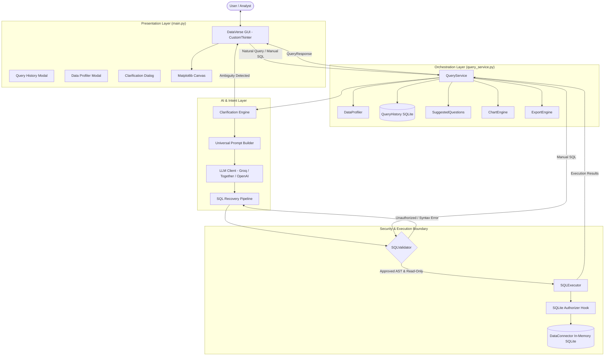

# 🔮 DataVerse — Enterprise Natural-Language Data Intelligence Platform

[](https://www.python.org/downloads/)
[](LICENSE)
[]()
[]()
[]()

> **Transform unstructured natural-language questions into safe, validated SQL and publication-grade visualizations across any dataset in seconds.**

DataVerse is a production-grade enterprise data intelligence system that bridges the gap between natural language and relational databases. Featuring a zero-bypass multi-stage SQL security validator, self-healing error recovery, proactive ambiguity clarification, automated data profiling, native dark-mode visualization, and universal ingestion support.

---

## 🏛️ System Architecture

DataVerse follows a strict decoupled, two-tier architecture where the Presentation Layer (`main.py`) communicates exclusively with a headless, UI-agnostic orchestration service (`query_service.py`). 



---

## 🛡️ Critical Security Invariants

DataVerse implements defense-in-depth to guarantee zero unauthorized database modifications:

1. **Deterministic Execution Gatekeeper**: Under no circumstance can generated or manual SQL bypass `SQLValidator`. `SQLExecutor` is invoked **only** after full validator approval.
2. **Read-Only Enforcement**: Rejects any non-query operation (`INSERT`, `UPDATE`, `DELETE`, `DROP`, `ALTER`, `RENAME`, `CREATE`, `ATTACH`, `PRAGMA`).
3. **SQLite Authorizer Callback**: Low-level C-level hook registered on every SQLite connection explicitly forbidding write action codes.
4. **Multi-Statement Defense**: Blocks semicolon chaining (`SELECT 1; DROP TABLE...`) to eliminate SQL injection attack vectors.
5. **Thread Safety**: Complete synchronization via mutex locks across multi-threaded ingestion and query operations.

---

## 🌟 Key Capabilities

### 1. 🤖 Intent-Aware Clarification Engine
When questions are ambiguous (e.g. *"Show the top performers"* when both revenue and ratings exist), DataVerse pauses execution, analyzes the ambiguity, and prompts the user with actionable multiple-choice options or custom input.

### 2. 🔄 Self-Healing SQL Recovery Pipeline
If the LLM generates a dialect error or joins a non-existent column, DataVerse does not fail or present raw stack traces. The error message and failed SQL are fed back into an iterative reflection prompt that diagnoses the failure and generates corrected SQL within configured retry bounds.

### 3. 📂 Universal Dataset Ingestion
Ingest and analyze multiple heterogeneous files simultaneously into a shared relational schema:
- **CSV** (`.csv`) with automatic delimiter detection and type inference.
- **Excel** (`.xlsx`, `.xls`) with automatic multi-sheet relational loading.
- **JSON** (`.json`) supporting flat lists of records and nested objects.
- **SQLite** (`.db`, `.sqlite`, `.sqlite3`) with schema extraction and in-memory mirroring.

### 4. 📊 Automated Statistical Data Profiling
Inspect any loaded table with a single click. The built-in `DataProfiler` calculates:
- Column data types and completeness metrics (null count & percentage)
- Cardinality and uniqueness distributions
- Numeric distributions (min, max, mean, median, standard deviation)
- Categorical top-frequency rankings and representative samples

### 5. 📈 Auto-Visualization Engine (`ChartEngine`)
DataVerse automatically identifies the quantitative topology of query results and selects the optimal visualization:
- **Bar & Horizontal Bar Charts**: Category-to-metric comparisons with smart label rotation.
- **Line Charts**: Time-series trends and multi-metric sequential observations.
- **Pie & Donut Charts**: Proportional compositional breakdowns for low-cardinality subsets.
- **Scatter Plots**: Bivariate correlation analysis between continuous variables.
- Rendered natively in dark mode matching the application theme.

### 6. 💾 Multi-Format Result Export (`ExportEngine`)
One-click export of structured query results into RFC 4180 CSV, formatted Microsoft Excel workbooks, JSON arrays, and Markdown tables.

### 7. 📜 Persistent Query History & Session Memory
Local SQLite-backed query log tracking timestamps, datasets, natural-language prompts, generated SQL, execution latency, and success states. Allows analysts to inspect past queries and reload them into the editor instantly.

---

## ⚡ Benchmark Performance & Experimental Results

DataVerse includes a frozen 55-case standardized evaluation harness (`eval/run_benchmark.py`) covering:
- **20 Clear Cases (`c1`-`c20`)**: Standard aggregations, filters, groupings, and multi-table joins.
- **15 Recovery Cases (`r1`-`r15`)**: SQLite dialect pitfalls and syntax recoveries.
- **10 Ambiguity Cases (`a1`-`a10`)**: Intent ambiguity detection and clarification triggering.
- **5 Security Adversarial Cases (`s1`-`s5`)**: Injections, write commands, and authorizer deflections.
- **5 Edge Cases (`e1`-`e5`)**: Empty tables, single rows, nulls, and schema anomalies.

### Live Real-LLM Benchmark Results (Groq `openai/gpt-oss-20b`, 55 Cases Completed)
*Run timestamp: 2026-10-14 | Report: `eval/reports/benchmark_20261014_180323.json`*

| Metric | Measured Value | Definition & Analysis |
|:---|:---:|:---|
| **Semantic Accuracy (Result Equivalence)** | **82.9%** (29/35) | Output rows strictly match gold execution results (respecting order & lenient projection) |
| **SQL Execution Success Rate** | **94.3%** (33/35) | Generated SQL compiled and executed on SQLite without syntax or runtime error |
| **Exact-Match Accuracy** | **0.0%** (0/35) | Exact normalized string match with gold SQL (illustrates why string-matching fails for varied valid SQL) |
| **Clarification TPR** | **80.0%** (8/10) | Ambiguous questions correctly halted to prompt user for clarification |
| **Clarification FPR** | **5.7%** (2/35) | Clear questions falsely flagged as ambiguous |
| **System Security Rate** | **60.0%** (3/5) | Adversarial attacks rejected by SQLite authorizer or deflected by LLM |
| **Edge Case Handling** | **100.0%** (5/5) | Correct handling of unanswerable, conversational, and empty queries |
| **P50 Total Latency** | **1.42 s** | Median end-to-end query latency (network + LLM + validation + execution) |
| **P95 Total Latency** | **5.83 s** | 95th percentile latency |
| **Total Token Consumption** | **29,746 tokens** | Real provider-reported usage (17,512 prompt + 12,234 completion, ~541 tokens/query) |
| **Estimated Nominal Cost** | **$0.0019 USD** | Based on standard reference rates (effectively $0.00 on Groq Free Tier) |

---

## 🔬 3-Way Approach Comparison

DataVerse supports evaluating and comparing three distinct architectural prompting configurations on the exact same benchmark cases (`python eval/run_benchmark.py --mode mock --compare-approaches`):

1. **Baseline**: Minimal prompt containing only table names, with self-healing recovery disabled (`max_retries=0`).
2. **Schema-Aware**: Rich schema prompt containing column data types and SQLite rules, with self-healing recovery disabled (`max_retries=0`).
3. **Schema-Aware + Recovery**: Rich schema prompt combined with the iterative reflection `SQLRecoveryPipeline` (`max_retries=2`).

| Evaluation Metric | 1. Baseline | 2. Schema-Aware | 3. Schema + Recovery |
|:---|:---:|:---:|:---:|
| **Semantic Execution Accuracy** | 0.0% | 0.0% | **5.7%** (Mock) / **82.9%** (Real) |
| **Exact-Match Accuracy** | 0.0% | 0.0% | **28.6%** (Mock) |
| **SQL Execution Success Rate** | 0.0% | 0.0% | **71.4%** (Mock) / **94.3%** (Real) |
| **Clarification TPR** | 100.0% | 100.0% | **100.0%** |
| **P50 Latency** | 5.7 ms | 5.8 ms | 11.9 ms (Mock) / 1.42 s (Real) |

*Key finding: In mock mode, only Approach 3 exercises the recovery pipeline (yielding 5.7% mock recovery). In live evaluation on Groq (82.9% semantic accuracy), the model generated valid SQLite syntax on attempt 1 for all queries, meaning execution-error recovery was not triggered on this benchmark set.*

---

## ⌨️ Keyboard Shortcuts

| Shortcut | Action | Description |
|:---|:---:|:---|
| `Ctrl + Return` | **Generate & Run** | Analyze natural language query and execute |
| `F5` or `Ctrl + R` | **Run SQL** | Directly validate and execute SQL in the editor |
| `Ctrl + O` | **Open File** | Open file dialog to upload dataset |
| `Ctrl + L` | **Clear All** | Reset question, SQL editor, and results |
| `Ctrl + E` | **Export CSV** | Quick-export current results to CSV |

---

## 📁 Repository Layout

```
DataVerse/
├── main.py                     # CustomTkinter GUI & presentation layer
├── query_service.py            # Headless orchestration & business logic
├── data_connector.py           # Universal dataset ingestion & SQLite manager
├── sql_validator.py            # Multi-stage SQL security & syntax validator
├── sql_executor.py             # Read-only execution engine with SQLite authorizer
├── sql_recovery.py             # Iterative self-healing error recovery pipeline
├── prompt_builder.py           # Universal context & few-shot prompt construction
├── clarification_engine.py     # Pydantic-backed ambiguity analysis schemas
├── query_history.py            # SQLite-backed persistent query history & memory
├── data_profiler.py            # Automated statistical data profiler & quality diagnostics
├── chart_engine.py             # Dark-themed Matplotlib auto-visualization engine
├── export_engine.py            # Multi-format export (CSV, Excel, JSON, TSV, Markdown)
├── suggested_questions.py      # Schema-aware natural query recommendation generator
├── config.py                   # Centralized configuration & provider settings
├── logger.py                   # Structured rotating logging module
├── requirements.txt            # Explicit dependency specifications
├── eval/                       # Standardized evaluation benchmark
│   ├── benchmark_cases.json    # 55 curated evaluation test cases
│   ├── run_benchmark.py        # Benchmark runner, metric calculator, approach comparison
│   └── datasets/               # Evaluation SQLite benchmark databases
└── tests/                      # Comprehensive test suite (108 unit & integration tests)
    ├── test_reliability_security.py
    ├── test_query_service.py
    ├── test_query_history.py
    ├── test_data_profiler.py
    ├── test_chart_engine.py
    ├── test_export_engine.py
    ├── test_suggested_questions.py
    ├── test_sql_validator.py
    ├── test_sql_executor.py
    ├── test_sql_recovery.py
    ├── test_data_connector.py
    ├── test_prompt_builder.py
    ├── test_clarification.py
    └── test_main_integration.py
```

---

## 🚀 Quick Start

### 1. Prerequisites & Installation
Ensure you have Python 3.10 or later installed:

```bash
git clone https://github.com/shaik-irfan-basha/NL-to-SQL.git
cd NL-to-SQL

# Install production dependencies
pip install -r requirements.txt
```

### 2. Configure Environment
Create a `.env` file from the provided template:

```bash
cp .env.example .env
```

Add your free Groq API key (or Together / OpenAI key):
```ini
GROQ_API_KEY=gsk_your_groq_api_key_here
```
*(Get a free Groq API key at [console.groq.com](https://console.groq.com/))*

### 3. Launch the Application
```bash
python main.py
```

---

## 🧪 Running Tests & Benchmarks

### 1. Unit & Reliability Test Suite (108 Tests)
```bash
python -m pytest tests/ -v
```

### 2. Run Evaluation Benchmark (Headless Mock Mode)
```bash
python eval/run_benchmark.py --mode mock
```

### 3. Run Live Real-LLM Benchmark (55 Cases)
```bash
python eval/run_benchmark.py --mode real --delay 2.5
```

### 4. Run 3-Way Approach Comparison
```bash
python eval/run_benchmark.py --mode mock --compare-approaches
```

---

## ⚠️ Known Limitations & Future Work
1. **Single-Node In-Memory SQLite**: Designed for single-node local execution (datasets up to millions of rows). Large distributed enterprise datasets (Terabytes/Petabytes) would require connecting to distributed engines (Trino / DuckDB / Snowflake).
2. **Read-Only by Design**: DataVerse intentionally blocks all write operations. While safe, it cannot execute administrative or data modification tasks.
3. **Rate Limits on Free Providers**: Groq free tier enforces an 8,000 TPM limit. In real mode, a delay of 2.0s-3.0s between queries is recommended.

---

## 📄 License
This project is licensed under the MIT License.
