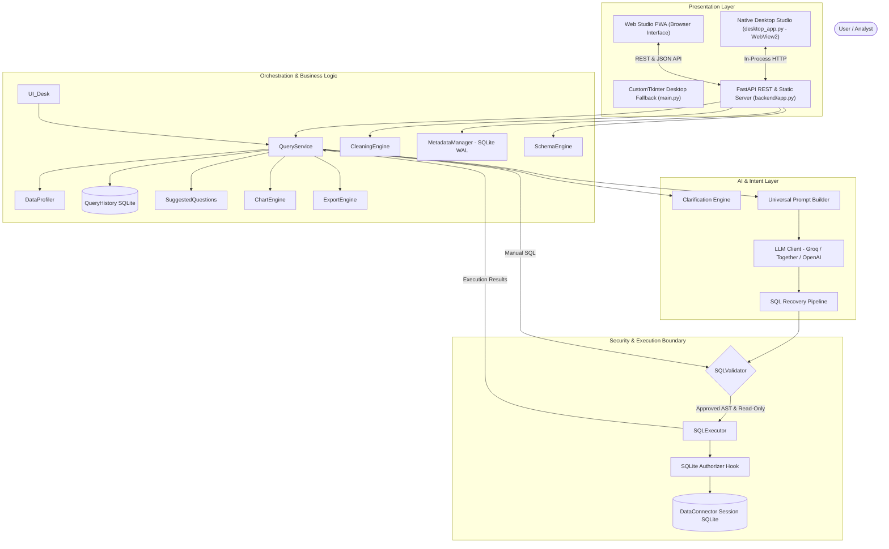

# 🔮 DataVerse — Enterprise Natural-Language Data Intelligence Platform

[](https://www.python.org/downloads/)
[](LICENSE)
[]()
[]()
[]()

> **Transform unstructured natural-language questions into safe, validated SQL and publication-grade visualizations across any dataset in seconds.**

DataVerse is a production-grade enterprise data intelligence system that bridges the gap between natural language and relational databases. Featuring a zero-bypass multi-stage SQL security validator, self-healing error recovery, proactive ambiguity clarification, conversational data cleaning, interactive relational schema exploration, automated data profiling, native dark-mode visualization, and universal ingestion support.

---

## 🏛️ System Architecture

DataVerse is engineered as **one unified product with a shared desktop & web foundation**:
1. **Desktop Studio (`desktop_app.py`)**: A native Windows desktop application powered by Microsoft Edge WebView2 and `pywebview`, running the complete Web Studio with instant feature parity, automatic port-conflict resolution, and backend lifecycle management.
2. **Web Studio (PWA)**: A modern, responsive workspace (`frontend/` + `backend/app.py`) providing interactive Schema Studio (ER diagram & JOIN builder), Conversational Cleaning Studio, real-time SQL Lab, Chart Studio, and Diagnostics.
3. **Fallback Desktop App (`main.py`)**: Preserved CustomTkinter GUI for lightweight local queries without WebView2 requirements.



---

## 🛡️ Critical Security Invariants

DataVerse implements defense-in-depth to guarantee zero unauthorized database modifications:

1. **Deterministic Execution Gatekeeper**: Under no circumstance can generated or manual SQL bypass `SQLValidator`. `SQLExecutor` is invoked **only** after full validator approval.
2. **Read-Only Enforcement**: Rejects any non-query operation (`INSERT`, `UPDATE`, `DELETE`, `DROP`, `ALTER`, `RENAME`, `CREATE`, `ATTACH`, `PRAGMA`).
3. **SQLite Authorizer Callback**: Low-level C-level hook registered on every SQLite connection explicitly forbidding write action codes.
4. **Multi-Statement Defense**: Blocks semicolon chaining (`SELECT 1; DROP TABLE...`) to eliminate SQL injection attack vectors.
5. **Thread Safety**: Complete synchronization via mutex locks across multi-threaded ingestion and query operations.

---

## 🌟 Key Capabilities

### 1. 🤖 Intent-Aware Clarification Engine
When questions are ambiguous (e.g. *"Show the top performers"* when both revenue and ratings exist), DataVerse pauses execution, analyzes the ambiguity, and prompts the user with actionable multiple-choice options or custom input.

### 2. 🔄 Self-Healing SQL Recovery Pipeline
If the LLM generates a dialect error or joins a non-existent column, DataVerse does not fail or present raw stack traces. The error message and failed SQL are fed back into an iterative reflection prompt that diagnoses the failure and generates corrected SQL within configured retry bounds.

### 3. 🧹 Conversational Data Cleaning Studio
Intelligent, audit-safe conversational data preparation:
- **Rule & NL Detection**: Detect and clean duplicate rows, handle missing values (impute median/mean/mode, drop rows/columns), normalize string casing/whitespace, and cast data types safely.
- **Audit-Safe Previews**: Inspect calculated transformation previews before any modification is applied to active session tables.
- **Multi-Level Undo & Revert**: Full linear transformation stack with granular undo and one-click revert to the original raw uploaded dataset.

### 4. 🗺️ Relational Schema Studio & Interactive Visualizer
Explore and manage multi-table relational architectures:
- **Automated Relationship Inference**: Detects candidate primary-foreign key relationships based on column naming, data types, uniqueness, and value overlap.
- **Interactive ER Diagram**: Dark-neon canvas with zoom, pan, fit-to-screen, table selection, and interactive column cards.
- **Relationship Management**: Explicitly confirm inferred relationships or reject false candidates; state is persisted in SQLite WAL metadata.
- **Visual JOIN Builder**: Select source and target tables to instantly generate safe, validated `INNER JOIN`, `LEFT JOIN`, and multi-table queries that load directly into SQL Lab.

### 5. 📂 Universal Dataset Ingestion & Demo Pack
Ingest and analyze multiple heterogeneous files simultaneously into an isolated session SQLite schema:
- **CSV** (`.csv`) with automatic delimiter detection and type inference.
- **Excel** (`.xlsx`, `.xls`) with automatic multi-sheet relational loading.
- **JSON** (`.json`) supporting flat lists of records and nested objects.
- **SQLite** (`.db`, `.sqlite`, `.sqlite3`) with schema extraction and in-memory mirroring.
- **Retail Demo Pack** (`sample_data/`): Includes pre-packaged `customers.csv` (100 rows), `orders.csv` (250 rows), `products.csv` (40 rows), and `retail_demo.sqlite` with relational keys and controlled data-quality test cases.

### 6. 📊 Automated Statistical Data Profiling & Diagnostics
Inspect any loaded table with a single click. The built-in `DataProfiler` and web Diagnostics tab calculate:
- Column data types and completeness metrics (null count & percentage)
- Cardinality and uniqueness distributions
- Numeric distributions (min, max, mean, median, standard deviation)
- Categorical top-frequency rankings, value chips, and representative samples
- Real-time table switching with zero-state fallbacks

### 7. 📈 Auto-Visualization Engine (`ChartEngine`)
DataVerse automatically identifies the quantitative topology of query results and renders publication-grade charts:
- **Bar & Horizontal Bar Charts**: Category-to-metric comparisons with smart label rotation.
- **Line Charts**: Time-series trends and multi-metric sequential observations.
- **Pie & Donut Charts**: Proportional compositional breakdowns for low-cardinality subsets.
- **Scatter Plots**: Bivariate correlation analysis between continuous variables.
- Interactive in-tab chart type selector and refresh controls in Web Studio, with native dark mode palette.

### 8. 💾 Multi-Format Result Export (`ExportEngine`)
One-click export of structured query results into RFC 4180 CSV, formatted Microsoft Excel workbooks, JSON arrays, and Markdown tables.

### 9. 📜 Persistent Query History & Session Metadata (`MetadataManager`)
Local SQLite-backed persistence (`dataverse_history.db` and `dataverse_meta.db` with WAL mode) tracking timestamps, datasets, prompts, generated SQL, execution latency, confirmed relational schemas, and cleaning transformation histories.

---

## ⚡ Benchmark Performance & Experimental Results

DataVerse includes a frozen 55-case standardized evaluation harness (`eval/run_benchmark.py`) covering:
- **20 Clear Cases (`c1`-`c20`)**: Standard aggregations, filters, groupings, and multi-table joins.
- **15 Recovery Cases (`r1`-`r15`)**: SQLite dialect pitfalls and syntax recoveries.
- **10 Ambiguity Cases (`a1`-`a10`)**: Intent ambiguity detection and clarification triggering.
- **5 Security Adversarial Cases (`s1`-`s5`)**: Injections, write commands, and authorizer deflections.
- **5 Edge Cases (`e1`-`e5`)**: Empty tables, single rows, nulls, and schema anomalies.

### Live Real-LLM Benchmark Results (Groq `openai/gpt-oss-20b`, 55 Cases Completed)
*Run timestamp: 2026-10-14 | Report: `eval/reports/benchmark_20261014_180323.json`*

| Metric | Measured Value | Definition & Analysis |
|:---|:---:|:---|
| **Semantic Accuracy (Result Equivalence)** | **82.9%** (29/35) | Output rows strictly match gold execution results (respecting order & lenient projection) |
| **SQL Execution Success Rate** | **94.3%** (33/35) | Generated SQL compiled and executed on SQLite without syntax or runtime error |
| **Exact-Match Accuracy** | **0.0%** (0/35) | Exact normalized string match with gold SQL (illustrates why string-matching fails for varied valid SQL) |
| **Clarification TPR** | **80.0%** (8/10) | Ambiguous questions correctly halted to prompt user for clarification |
| **Clarification FPR** | **5.7%** (2/35) | Clear questions falsely flagged as ambiguous |
| **System Security Rate** | **60.0%** (3/5) | Adversarial attacks rejected by SQLite authorizer or deflected by LLM |
| **Edge Case Handling** | **100.0%** (5/5) | Correct handling of unanswerable, conversational, and empty queries |
| **P50 Total Latency** | **1.42 s** | Median end-to-end query latency (network + LLM + validation + execution) |
| **P95 Total Latency** | **5.83 s** | 95th percentile latency |
| **Total Token Consumption** | **29,746 tokens** | Real provider-reported usage (17,512 prompt + 12,234 completion, ~541 tokens/query) |
| **Estimated Nominal Cost** | **$0.0019 USD** | Based on standard reference rates (effectively $0.00 on Groq Free Tier) |

---

## 🔬 3-Way Approach Comparison

DataVerse supports evaluating and comparing three distinct architectural prompting configurations on the exact same benchmark cases (`python eval/run_benchmark.py --mode mock --compare-approaches`):

1. **Baseline**: Minimal prompt containing only table names, with self-healing recovery disabled (`max_retries=0`).
2. **Schema-Aware**: Rich schema prompt containing column data types and SQLite rules, with self-healing recovery disabled (`max_retries=0`).
3. **Schema-Aware + Recovery**: Rich schema prompt combined with the iterative reflection `SQLRecoveryPipeline` (`max_retries=2`).

| Evaluation Metric | 1. Baseline | 2. Schema-Aware | 3. Schema + Recovery |
|:---|:---:|:---:|:---:|
| **Semantic Execution Accuracy** | 0.0% | 0.0% | **5.7%** (Mock) / **82.9%** (Real) |
| **Exact-Match Accuracy** | 0.0% | 0.0% | **28.6%** (Mock) |
| **SQL Execution Success Rate** | 0.0% | 0.0% | **71.4%** (Mock) / **94.3%** (Real) |
| **Clarification TPR** | 100.0% | 100.0% | **100.0%** |
| **P50 Latency** | 5.7 ms | 5.8 ms | 11.9 ms (Mock) / 1.42 s (Real) |

*Key finding: In mock mode, only Approach 3 exercises the recovery pipeline (yielding 5.7% mock recovery). In live evaluation on Groq (82.9% semantic accuracy), the model generated valid SQLite syntax on attempt 1 for all queries, meaning execution-error recovery was not triggered on this benchmark set.*

---

## ⌨️ Keyboard Shortcuts

| Shortcut | Action | Description |
|:---|:---:|:---|
| `Ctrl + Return` | **Generate & Run** | Analyze natural language query and execute |
| `F5` or `Ctrl + R` | **Run SQL** | Directly validate and execute SQL in the editor |
| `Ctrl + O` | **Open File** | Open file dialog to upload dataset |
| `Ctrl + L` | **Clear All** | Reset question, SQL editor, and results |
| `Ctrl + E` | **Export CSV** | Quick-export current results to CSV |

---

## 📁 Repository Layout

```
DataVerse/
├── backend/                    # FastAPI REST API & static server
│   ├── app.py                  # API endpoints (SQL, cleaning, schema, upload, health)
│   └── __init__.py
├── frontend/                   # Web Studio responsive PWA
│   ├── index.html              # Studio single-page application
│   ├── css/                    # Dark neon design styles & responsive layouts
│   └── js/                     # Modular frontend state, canvas, tables, charts, diagnostics
├── sample_data/                # Realistic retail demo dataset pack
│   ├── retail_demo.sqlite      # SQLite database with relational keys
│   ├── customers.csv           # 100 customer records with data cleaning edge cases
│   ├── orders.csv              # 250 orders referencing customers & products
│   ├── products.csv            # 40 products across 6 retail categories
│   └── README.md               # Dataset documentation & test cases
├── desktop_app.py              # Native Windows Desktop Studio (WebView2 wrapper)
├── main.py                     # CustomTkinter Windows desktop GUI fallback
├── query_service.py            # Headless orchestration & business logic
├── cleaning_engine.py          # Conversational data cleaning, transformations & undo/revert
├── schema_engine.py            # Relational schema inference, ER visualizer & JOIN builder
├── metadata_manager.py         # Persistent metadata & session store (SQLite WAL)
├── data_connector.py           # Universal dataset ingestion & SQLite manager
├── sql_validator.py            # Multi-stage SQL security & syntax validator
├── sql_executor.py             # Read-only execution engine with SQLite authorizer
├── sql_recovery.py             # Iterative self-healing error recovery pipeline
├── prompt_builder.py           # Universal context & few-shot prompt construction
├── clarification_engine.py     # Pydantic-backed ambiguity analysis schemas
├── query_history.py            # SQLite-backed persistent query history & memory
├── data_profiler.py            # Automated statistical data profiler & quality diagnostics
├── chart_engine.py             # Dark-themed Matplotlib auto-visualization engine
├── export_engine.py            # Multi-format export (CSV, Excel, JSON, TSV, Markdown)
├── suggested_questions.py      # Schema-aware natural query recommendation generator
├── config.py                   # Centralized configuration & provider settings
├── logger.py                   # Structured rotating logging module
├── run.bat                     # Windows one-click launcher (Web Studio or Desktop)
├── create_desktop_shortcut.ps1 # PowerShell script to create Desktop shortcut
├── requirements.txt            # Production and test dependencies (FastAPI, pywebview, etc.)
├── eval/                       # Standardized evaluation benchmark (55 cases)
└── tests/                      # Full test suite (256 tests across 21 test files)
    ├── test_desktop_app.py             # Shared WebView desktop wrapper lifecycle & port tests
    ├── test_phase4_validation.py       # Phase 4 schema, JOIN, chart & diagnostics tests
    ├── test_phase3_acceptance_audit.py # Phase 3 conversational cleaning audit tests
    ├── test_browser_acceptance.py      # Headless Chrome E2E browser tests
    ├── test_schema_endpoints.py        # Schema visualizer REST API tests
    ├── test_schema_engine.py           # Relationship inference & JOIN generation
    ├── test_cleaning_engine.py         # Data cleaning transformations & undo stack
    ├── test_persistent_metadata.py     # Metadata persistence & WAL migrations
    ├── test_session_isolation.py       # Multi-session state isolation tests
    ├── test_demo_data.py               # Demo dataset pack relational integrity
    ├── test_api_endpoints.py           # FastAPI REST API unit & integration tests
    ├── test_frontend_pwa.py            # Frontend asset and PWA compliance tests
    ├── test_byok.py                    # Bring-Your-Own-Key header tests
    ├── test_main_integration.py        # Desktop CustomTkinter integration tests
    ├── test_reliability_security.py   # Security invariant verification
    ├── test_query_service.py           # Orchestration layer tests
    ├── test_query_history.py           # Query history persistence tests
    ├── test_data_profiler.py           # Statistical profiling tests
    ├── test_chart_engine.py            # Chart visualization tests
    ├── test_export_engine.py           # Multi-format export tests
    └── test_sql_validator.py           # SQL syntax and security gatekeeper tests
```

---

## 🚀 Quick Start

### 1. Prerequisites & Installation
Ensure you have Python 3.10 or later installed:

```bash
git clone https://github.com/shaik-irfan-basha/DataVerse.git
cd DataVerse

# Install dependencies (including FastAPI, uvicorn, pywebview, selenium)
pip install -r requirements.txt
```

### 2. Configure Environment
Create a `.env` file from the provided template:

```bash
cp .env.example .env
```

Add your free Groq API key (or Together / OpenAI key):
```ini
GROQ_API_KEY=gsk_your_groq_api_key_here
```
*(Get a free Groq API key at [console.groq.com](https://console.groq.com/))*

### 3. Launching DataVerse

#### Method A: Windows One-Click Launcher (`run.bat`) — Recommended
DataVerse includes a preconfigured Windows batch runner:
- **Desktop Studio (WebView2)**: Run `run.bat --desktop` to launch the native Windows desktop studio.
- **Web Studio (Browser)**: Run `run.bat` (or double-click it in Windows Explorer). It starts the FastAPI server and automatically opens `http://localhost:8000` in your default browser.
- **Legacy Desktop GUI**: Run `run.bat --legacy` to launch the native CustomTkinter fallback GUI.

#### Method B: Desktop Studio Manual Start
```bash
python desktop_app.py
```

#### Method C: Web Studio PWA Manual Start
```bash
python -m uvicorn backend.app:app --host 127.0.0.1 --port 8000
```
Open [http://127.0.0.1:8000](http://127.0.0.1:8000) in any modern browser.

#### Method D: CustomTkinter Fallback GUI
```bash
python main.py
```

To create a convenient Windows desktop shortcut for one-click launching:
```powershell
powershell -ExecutionPolicy Bypass -File create_desktop_shortcut.ps1
```

---

## 🧪 Running Tests & Benchmarks

### 1. Full Automated Test Suite (254 Tests)
```bash
python -m pytest tests/ -v
```

### 2. Desktop Wrapper Integration Tests
```bash
python -m pytest tests/test_desktop_app.py -v
```

### 3. End-to-End Browser Acceptance Tests (Headless Chrome)
```bash
python -m pytest tests/test_browser_acceptance.py -v
```

### 3. Desktop Application Integration Tests
```bash
python -m pytest tests/test_main_integration.py -v
```

### 4. Run Evaluation Benchmark (Headless Mock Mode, 55 Cases)
```bash
python eval/run_benchmark.py --mode mock
```

### 5. Run Live Real-LLM Benchmark (55 Cases)
```bash
python eval/run_benchmark.py --mode real --delay 2.5
```

### 6. Run 3-Way Approach Comparison
```bash
python eval/run_benchmark.py --mode mock --compare-approaches
```

---

## ⚠️ Known Limitations & Future Work
1. **Single-Node In-Memory SQLite**: Designed for single-node local execution (datasets up to millions of rows). Large distributed enterprise datasets (Terabytes/Petabytes) would require connecting to distributed engines (Trino / DuckDB / Snowflake).
2. **Read-Only by Design**: DataVerse intentionally blocks all write operations. While safe, it cannot execute administrative or data modification tasks.
3. **Rate Limits on Free Providers**: Groq free tier enforces an 8,000 TPM limit. In real mode, a delay of 2.0s-3.0s between queries is recommended.

---

## 📄 License
This project is licensed under the MIT License.
