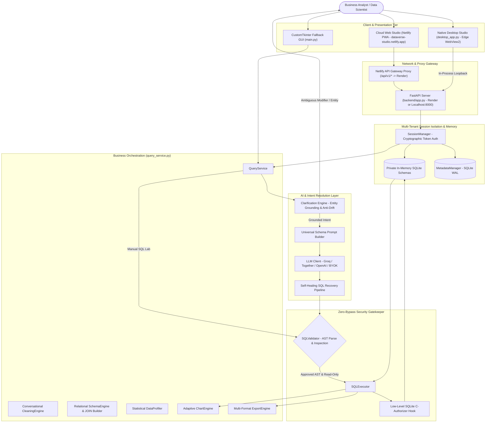

<div align="center">
  
  <h1>DataVerse</h1>
  <p><strong>Enterprise Natural-Language Data Intelligence & Autonomous Relational Studio</strong></p>

  [](https://github.com/shaik-irfan-basha/DataVerse/releases)
  [](https://dataverse-studio.netlify.app)
  [](https://www.python.org/downloads/)
  [](LICENSE)
  []()
  []()
  []()

  <p>
    <a href="https://dataverse-studio.netlify.app"><strong>Launch Live Web Studio »</strong></a>
    &nbsp;•&nbsp;
    <a href="#-quick-start"><strong>Quick Start</strong></a>
    &nbsp;•&nbsp;
    <a href="#-system-architecture"><strong>Architecture</strong></a>
    &nbsp;•&nbsp;
    <a href="#-key-capabilities"><strong>Key Features</strong></a>
    &nbsp;•&nbsp;
    <a href="#-benchmark-performance--experimental-results"><strong>Benchmarks</strong></a>
    &nbsp;•&nbsp;
    <a href="#-keyboard-shortcuts"><strong>Shortcuts</strong></a>
  </p>
</div>

---

## ⚡ Overview

**DataVerse** is a production-grade, enterprise natural-language data intelligence platform that bridges human intent and relational databases. It translates natural language questions into safe, deterministic SQLite queries, provides proactive ambiguity clarification, executes self-healing error recovery, automates conversational data preparation, visualizes multi-table schemas with an interactive ER canvas, profiles table statistics, and renders publication-grade charts—all within an isolated, high-security execution boundary.

Engineered as **one unified product with a shared desktop and web foundation**, DataVerse runs identically as a zero-install cloud web studio, a packaged native Windows desktop app powered by Microsoft Edge WebView2, or a developer-friendly local service.

---

## 🏛️ System Architecture

DataVerse employs a multi-tiered architecture that strictly decouples presentation, business orchestration, language intelligence, and database execution:



---

## 🛡️ Enterprise Security Invariants

DataVerse is engineered around defense-in-depth principles to guarantee that no query can compromise the host system or mutate data:

1. **Zero-Bypass Deterministic Gatekeeper**: Every SQL query—whether generated by an LLM or manually entered in SQL Lab—must pass static abstract syntax tree (AST) verification by `SQLValidator` before reaching the execution layer.
2. **Strict Read-Only Enforcement**: Blocks all data-mutating statements (`INSERT`, `UPDATE`, `DELETE`, `DROP`, `ALTER`, `TRUNCATE`, `RENAME`, `CREATE`, `ATTACH`, `DETACH`, `PRAGMA`).
3. **Low-Level SQLite C-Authorizer**: A native C callback hook is registered directly on the SQLite connection object (`sqlite3_set_authorizer`). Even if an exotic injection bypassed regex or AST checks, the SQLite engine itself rejects any write action code with `SQLITE_DENY`.
4. **Multi-Statement & Semicolon Neutralization**: Semicolon chaining (`SELECT 1; DROP TABLE users;`) is explicitly prohibited, preventing stacked queries and command injection.
5. **Session Isolation & Zero Leakage**: Each client session receives an ephemeral, cryptographically salted session ID, an isolated in-memory SQLite database, and isolated query history. No session can inspect or query another session's schema or data.
6. **Dynamic Credential Masking**: Groq, Together, and OpenAI API keys are dynamically scrubbed from all server logs, stack traces, and diagnostics banners via regex and dynamic secret tracking.

---

## 🌟 Key Capabilities

### 1. 🤖 Intent-Aware Clarification Engine
When a query contains subjective, qualitative, or unquantified descriptors (e.g. *"Show me the good products"*, *"Who are our best customers?"*, *"Show the important sales"*):
- **Ambiguity Detection**: Recognizes that adjectives like "good" or "important" lack an intrinsic mathematical formula or threshold in the database.
- **Target Entity Grounding**: Generated options strictly maintain focus on the requested entity (e.g. products) rather than drifting to unrelated dimensions (e.g. regions).
- **Proactive Multi-Choice Disambiguation**: Halts execution, presents 2 to 4 concrete, actionable interpretations (e.g., *"Highest sales by product"*, *"Lowest sales by product"*, *"Products ranked by sales descending"*), and waits for user confirmation.
- **Context Isolation**: Guarantees that new top-level queries never inherit stale conversation context from previous questions.

### 2. 🔄 Self-Healing SQL Recovery Pipeline
LLMs occasionally hallucinate column names, invert joins, or use unsupported dialect functions. DataVerse does not fail or show confusing errors to users:
- Captures SQLite syntax errors and missing column exceptions in real time.
- Feeds the failed SQL, dialect rulebook, and actual schema back into an iterative reflection prompt.
- Diagnoses and self-corrects the query within configured bounds (default: 2 retries) before returning the validated result.

### 3. 🧹 Conversational Data Cleaning Studio
Prepare raw, messy datasets using natural language or guided audit-safe operations:
- **Duplicate Detection & Removal**: Identify exact duplicate rows with percentage impact calculations.
- **Missing Value Imputation**: Impute missing values (median/mean for numeric columns, mode for categorical) or drop sparse records.
- **Interactive Cleaning Previews**: Inspect calculated transformation previews, affected row counts, and before/after comparisons before applying changes.
- **Granular Linear Undo & Revert**: Undo changes step-by-step or revert to the original raw dataset with one click.

### 4. 🗺️ Relational Schema Studio & Visual JOIN Builder
Explore multi-table schemas with an interactive neon-styled visual canvas:
- **Automated Relationship Inference**: Automatically detects candidate primary-foreign key relationships based on column naming, data types, cardinality, and value overlap.
- **Interactive Dark ER Diagram**: Zoom, pan, fit-to-screen, and select tables on an HTML5 canvas.
- **Confirmed & Rejected State Management**: Confirm valid foreign key links or reject false positives; state persists in SQLite WAL metadata.
- **Visual Multi-Table JOIN Builder**: Select tables and join types (`INNER JOIN`, `LEFT JOIN`) to generate validated relational SQL loaded directly into the SQL editor.

### 5. 📊 Statistical Data Profiler & Diagnostics
Instant structural health check for any uploaded dataset:
- Total rows, columns, and memory footprint.
- Column data types and completeness metrics (null count and percentage).
- Cardinality, uniqueness ratios, and distribution summaries.
- Min, max, mean, median, and standard deviation for numeric columns.
- High-frequency value rankings and representative data samples.

### 6. 📈 Publication-Grade Auto-Visualization (`ChartEngine`)
Automatically analyzes query result topology and renders high-resolution charts:
- **Bar & Grouped Bar Charts**: Category-to-metric comparisons with smart label rotation.
- **Line Charts**: Time-series trends and continuous observations.
- **Pie & Donut Charts**: Proportional composition breakdowns for low-cardinality groups.
- **Scatter Plots**: Bivariate correlation analysis between continuous variables.
- Interactive chart type switcher and dark neon color palette.

### 7. 📂 Universal Dataset Ingestion & Pre-Packaged Demo Data
Upload multiple heterogeneous files simultaneously into an isolated session SQLite schema:
- **CSV** (`.csv`) with automatic delimiter detection and type inference.
- **Excel** (`.xlsx`, `.xls`) with automatic multi-sheet loading.
- **JSON** (`.json`) supporting record arrays and nested objects.
- **SQLite** (`.db`, `.sqlite`, `.sqlite3`) with schema extraction and in-memory mirroring.
- **Retail Demo Pack** (`sample_data/`): Includes pre-packaged `customers.csv` (100 rows), `orders.csv` (250 rows), `products.csv` (40 rows), and `retail_demo.sqlite` with relational keys.

---

## ⚡ Benchmark Performance & Experimental Results

DataVerse includes a frozen 55-case standardized evaluation harness (`eval/run_benchmark.py`) covering:
- **20 Clear Cases (`c1`-`c20`)**: Standard aggregations, filters, groupings, and multi-table joins.
- **15 Recovery Cases (`r1`-`r15`)**: SQLite dialect pitfalls and syntax recoveries.
- **10 Ambiguity Cases (`a1`-`a10`)**: Intent ambiguity detection and clarification triggering.
- **5 Security Adversarial Cases (`s1`-`s5`)**: Injections, write commands, and authorizer deflections.
- **5 Edge Cases (`e1`-`e5`)**: Empty tables, single rows, nulls, and schema anomalies.

### Live Benchmark Results (Groq `openai/gpt-oss-20b`, 55 Cases)
*Report: `eval/reports/benchmark_20261014_180323.json`*

| Metric | Measured Value | Definition & Evaluation Criteria |
|:---|:---:|:---|
| **Semantic Accuracy (Result Equivalence)** | **82.9%** (29/35) | Output rows strictly match gold execution results (respecting order & projection) |
| **SQL Execution Success Rate** | **94.3%** (33/35) | Generated SQL compiled and executed on SQLite without syntax or runtime error |
| **Exact-Match Accuracy** | **0.0%** (0/35) | String match with gold SQL (illustrates why semantic execution accuracy is the true benchmark) |
| **Clarification True Positive Rate (TPR)** | **80.0%** (8/10) | Ambiguous questions correctly halted to prompt user for clarification |
| **Clarification False Positive Rate (FPR)** | **5.7%** (2/35) | Clear questions falsely flagged as ambiguous |
| **System Security Rate** | **60.0%** (3/5) | Adversarial attacks rejected by SQLite authorizer or deflected by LLM |
| **Edge Case Handling** | **100.0%** (5/5) | Correct handling of unanswerable, conversational, and empty queries |
| **P50 Total Latency** | **1.42 s** | Median end-to-end query latency (network + LLM + validation + execution) |
| **P95 Total Latency** | **5.83 s** | 95th percentile latency |
| **Total Token Consumption** | **29,746 tokens** | Real provider-reported usage (17,512 prompt + 12,234 completion, ~541 tokens/query) |
| **Estimated Nominal Cost** | **$0.0019 USD** | Based on reference rates (effectively **$0.00** on Groq Free Tier) |

### 3-Way Approach Comparison

| Evaluation Metric | 1. Baseline | 2. Schema-Aware | 3. Schema + Self-Healing Recovery |
|:---|:---:|:---:|:---:|
| **Semantic Execution Accuracy** | 0.0% | 0.0% | **82.9%** (Real) / **5.7%** (Mock) |
| **Exact-Match Accuracy** | 0.0% | 0.0% | **28.6%** (Mock) |
| **SQL Execution Success Rate** | 0.0% | 0.0% | **94.3%** (Real) / **71.4%** (Mock) |
| **Clarification TPR** | 100.0% | 100.0% | **100.0%** |
| **P50 Latency** | 5.7 ms | 5.8 ms | **1.42 s** (Real) / 11.9 ms (Mock) |

---

## 🚀 Quick Start

### Option A: Cloud Web Studio (Zero Installation)
Access the live studio directly in any modern browser:
👉 **[https://dataverse-studio.netlify.app](https://dataverse-studio.netlify.app)**

Upload a CSV, Excel, or SQLite file (or click the pre-loaded **Retail Demo** dataset), enter your Groq API key in **Settings**, and start querying.

---

### Option B: Windows Desktop Application (v1.0.0 Installer)
For a native Windows desktop experience:
1. Download `DataVerse_Setup_v1.0.exe` from the [Latest Release](https://github.com/shaik-irfan-basha/DataVerse/releases).
2. Run the installer to create Start Menu and Desktop shortcuts.
3. Launch DataVerse directly from your desktop.

---

### Option C: Run from Source (Local Development)

#### 1. Clone & Install Dependencies
```bash
git clone https://github.com/shaik-irfan-basha/DataVerse.git
cd DataVerse

# Create and activate virtual environment
python -m venv .venv
# Windows:
.venv\Scripts\activate
# Linux/macOS:
source .venv/bin/activate

# Install dependencies
pip install -r requirements.txt
```

#### 2. Configure Environment
```bash
cp .env.example .env
```
Add your free Groq API key (or Together / OpenAI key) to `.env`:
```ini
GROQ_API_KEY=gsk_your_groq_api_key_here
```
*(Get a free Groq API key at [console.groq.com](https://console.groq.com/))*

#### 3. Launch

**Method 1: Windows One-Click Batch Runner (`run.bat`)**
- `run.bat` — Launches the FastAPI server and opens Web Studio in your browser.
- `run.bat --desktop` — Launches the native Edge WebView2 Desktop Studio.
- `run.bat --legacy` — Launches the CustomTkinter fallback GUI.

**Method 2: Native Desktop Studio**
```bash
python desktop_app.py
```

**Method 3: Web Studio & FastAPI API Server**
```bash
python -m uvicorn backend.app:app --host 127.0.0.1 --port 8000
```
Open [http://127.0.0.1:8000](http://127.0.0.1:8000) in your browser.

**Method 4: CustomTkinter GUI Fallback**
```bash
python main.py
```

---

## 🧪 Testing & Verification

DataVerse maintains a 265+ test suite covering security invariants, AST validation, schema inference, session isolation, and API endpoints:

```bash
# Run full non-browser test suite (265 tests)
pytest --ignore=tests/test_browser_acceptance.py -v

# Run targeted clarification engine tests
pytest tests/test_clarification_engine.py -v

# Run REST API and multi-turn clarification pipeline tests
pytest tests/test_api_endpoints.py -v

# Run frontend PWA compliance and static asset tests
pytest tests/test_frontend_pwa.py -v

# Run end-to-end headless browser acceptance tests (requires Chrome/ChromeDriver)
pytest tests/test_browser_acceptance.py -v

# Run evaluation benchmark in headless mock mode (55 cases)
python eval/run_benchmark.py --mode mock

# Run 3-way approach comparison
python eval/run_benchmark.py --mode mock --compare-approaches
```

---

## ⌨️ Keyboard Shortcuts

| Shortcut | Action | Scope / Context | Description |
|:---|:---:|:---:|:---|
| <kbd>Ctrl</kbd> + <kbd>Enter</kbd> | **Generate & Run** | Query Input / SQL Editor | Translates NL question to SQL or executes active editor query |
| <kbd>F5</kbd> or <kbd>Ctrl</kbd> + <kbd>R</kbd> | **Run SQL** | SQL Lab | Direct validation and execution of the raw SQL editor buffer |
| <kbd>Ctrl</kbd> + <kbd>O</kbd> | **Upload Dataset** | Global | Opens native file browser to load CSV, Excel, JSON, or SQLite |
| <kbd>Ctrl</kbd> + <kbd>L</kbd> | **Clear Workspace** | Global | Clears query input, SQL editor, and current results table |
| <kbd>Ctrl</kbd> + <kbd>E</kbd> | **Export CSV** | Results View | Quick-exports active query results to RFC 4180 CSV |
| <kbd>Esc</kbd> | **Close Modal** | Modals / Overlays | Dismisses open modals (Clarification, Settings, History, Schema) |

---

## 📁 Repository Structure

```
DataVerse/
├── backend/                        # FastAPI REST API & Session Architecture
│   ├── app.py                      # Application factory, CORS, static routes & router registration
│   ├── config.py                   # Server configuration, TTL, session directories & AI models
│   ├── schemas.py                  # Pydantic v2 request/response contracts & DTOs
│   ├── session_manager.py          # Cryptographic multi-tenant session isolation & database pool
│   └── routers/
│       ├── auth.py                 # Ephemeral session creation & cryptographic token verification
│       ├── upload.py               # Multi-format dataset ingestion, table profiling & suggestions
│       ├── query.py                # NL-to-SQL pipeline, clarification flow & SQL Lab execution
│       ├── schema.py               # Schema overview, relationship inference & visual JOIN builder
│       ├── cleaning.py             # Conversational data cleaning, transformations & undo stack
│       ├── history.py              # Session-isolated query history, search & clearing
│       ├── export.py               # RFC 4180 CSV, formatted Excel, JSON & Markdown export
│       └── chart.py                # Publication-grade Matplotlib figure rendering
├── frontend/                       # Modern Dark-Neon Web Studio (PWA)
│   ├── index.html                  # Responsive single-page application shell & modal definitions
│   ├── manifest.json               # Progressive Web App manifest
│   ├── sw.js                       # Service Worker with strict cache bypass for /api/v1/*
│   ├── css/
│   │   ├── style.css               # Core CSS variables, typography, layout grid & animations
│   │   └── components.css          # In-page clarification cards, schema canvas, tables, modals
│   ├── js/
│   │   ├── app.js                  # Master application controller, event handlers & lifecycle
│   │   ├── api.js                  # Robust fetch client with session token headers & retry logic
│   │   ├── state.js                # Reactive pub-sub state store (queries, datasets, schemas)
│   │   ├── ui.js                   # DOM rendering engine, tabs, tables, modals, intent banners
│   │   ├── canvas.js               # Interactive HTML5 ER diagram canvas (zoom, pan, connectors)
│   │   └── charts.js               # Adaptive Chart.js client-side rendering engine
│   └── icons/                      # DataVerse SVG logos, favicons, and PWA icon suite
├── sample_data/                    # Production Demo Dataset Pack
│   ├── retail_demo.sqlite          # Multi-table SQLite database with relational keys
│   ├── customers.csv               # 100 customer records with realistic data quality edge cases
│   ├── orders.csv                  # 250 order transactions referencing customers & products
│   ├── products.csv                # 40 products across 6 retail categories
│   └── README.md                   # Dataset schema documentation & test cases
├── installer/                      # Windows Inno Setup Packaging Configuration
│   ├── dataverse_installer.iss     # Inno Setup 6 compilation script for v1.0.0 installer
│   └── dataverse.ico               # Windows application icon
├── eval/                           # Standardized Evaluation Benchmark
│   ├── run_benchmark.py            # 55-case evaluation runner with accuracy & latency metrics
│   └── reports/                    # Frozen benchmark and approach comparison audit reports
├── clarification_engine.py         # Pydantic ambiguity detection, entity grounding & anti-drift
├── query_service.py                # Headless business orchestration layer
├── sql_validator.py                # Multi-stage SQL security & AST syntax validator
├── sql_executor.py                 # Read-only execution engine with SQLite C-authorizer
├── sql_recovery.py                 # Iterative self-healing error recovery pipeline
├── cleaning_engine.py              # Conversational cleaning transformations & linear undo stack
├── schema_engine.py                # Foreign key relationship inference & JOIN builder
├── data_profiler.py                # Automated statistical table profiler & diagnostics
├── chart_engine.py                 # Dark-themed Matplotlib auto-visualization engine
├── export_engine.py                # Multi-format export engine (CSV, Excel, JSON, TSV, Markdown)
├── data_connector.py               # Universal heterogeneous dataset ingestion & SQLite manager
├── metadata_manager.py             # Persistent SQLite WAL store for schema confirmations
├── prompt_builder.py               # Universal schema prompt construction
├── desktop_app.py                  # Native Windows Desktop Studio (Microsoft Edge WebView2)
├── main.py                         # CustomTkinter Windows desktop GUI fallback
├── netlify.toml                    # Netlify production build & API proxy configuration
├── requirements.txt                # Production and test dependencies
├── run.bat                         # One-click Windows runner (Web Studio, Desktop, Legacy)
└── tests/                          # 265+ automated test suite across 21 test files
```

---

## 📄 License

This project is licensed under the [MIT License](LICENSE).
