# DataVerse Demo Dataset Pack — Aura Retail

This directory contains a realistic, deterministic, and fully reproducible demo dataset pack for testing and demonstrating **DataVerse**.

The dataset models a fictional modern direct-to-consumer and B2B retail brand, **Aura Retail**. All names, contact details, and transactions are entirely fictional and generated using standard reserved example domains (`@example.com`).

---

## 📁 File Inventory

| File | Type | Rows | Description |
|---|:---:|:---:|---|
| [`customers.csv`](./customers.csv) | CSV | 100 | Customer directory with demographics, contact info, and membership tiers. |
| [`products.csv`](./products.csv) | CSV | 40 | Catalog of goods spanning Electronics, Apparel, Home & Kitchen, and Office Supplies. |
| [`orders.csv`](./orders.csv) | CSV | 250 | Transactional sales orders linking customers to purchased products. |
| [`customers_dirty.csv`](./customers_dirty.csv) | CSV | 104 | Dedicated test fixture containing 4 duplicate records and casing noise for cleaning demos. |
| [`retail_demo.sqlite`](./retail_demo.sqlite) | SQLite | 390 total | Pre-built SQLite database containing all three relational tables with explicit PK/FK constraints. |
| [`example_queries.sql`](./example_queries.sql) | SQL | 7 queries | Dialect-accurate SQLite queries covering joins, aggregations, and outer anti-joins. |
| [`generate_demo_data.py`](./generate_demo_data.py) | Python | — | Deterministic generator script using fixed seed (`SEED = 42`). |

---

## 🔗 Relational Schema & Entity Relationships

```mermaid
erDiagram
    CUSTOMERS ||--o{ ORDERS : "places (1:N)"
    PRODUCTS ||--o{ ORDERS : "ordered in (1:N)"

    CUSTOMERS {
        int customer_id PK
        string first_name
        string last_name
        string email
        string phone "Nullable (~6% missing)"
        string city "Intentional whitespace/casing"
        string state "Intentional lowercase"
        string postal_code "Nullable (~4% missing)"
        date signup_date
        string customer_segment
    }

    PRODUCTS {
        int product_id PK
        string product_name
        string category "Intentional whitespace/casing"
        float price
        float cost "Nullable (~7% missing)"
        int stock_quantity
        string status
    }

    ORDERS {
        int order_id PK
        int customer_id FK
        int product_id FK
        date order_date
        int quantity "Includes realistic outliers (25, 40)"
        float unit_price
        float total_amount
        string status
        string payment_method "Nullable (~2% missing)"
        string shipping_city
    }
```



### Key Integrity Rules
- **Primary Keys**:
  - `customers.customer_id` (1 to 100, unique, 0 nulls)
  - `products.product_id` (1 to 40, unique, 0 nulls)
  - `orders.order_id` (1001 to 1250, unique, 0 nulls)
- **Foreign Keys**:
  - `orders.customer_id` strictly references `customers.customer_id`.
  - `orders.product_id` strictly references `products.product_id`.
  - **Zero orphan records**: Referential integrity is 100% maintained so that all relational queries and Schema Studio visualizations resolve correctly.
- **Intentional Outer-Join Cohort**:
  - Customer IDs `90` through `100` have placed **0 orders**. This enables testing `LEFT JOIN ... WHERE orders.order_id IS NULL` to identify inactive customers.

---

## 📋 Column Dictionary

### `customers.csv`
- `customer_id` (Integer): Unique customer identifier (PK).
- `first_name` (Text): Customer first name.
- `last_name` (Text): Customer last name.
- `email` (Text): Reserved example email address (`firstname.lastnameN@example.com`).
- `phone` (Text): Fictional telephone number. Nullable.
- `city` (Text): Customer city. Contains controlled formatting issues for text-cleaning demos.
- `state` (Text): Two-letter US state code. Contains controlled lowercase entries.
- `postal_code` (Text): 5-digit ZIP code. Nullable.
- `signup_date` (Date string `YYYY-MM-DD`): Account registration date.
- `customer_segment` (Text): Segmentation tier (`Standard`, `Premium`, `VIP`, `Enterprise`).

### `products.csv`
- `product_id` (Integer): Unique product SKU identifier (PK).
- `product_name` (Text): Descriptive product title.
- `category` (Text): Department category (`Electronics`, `Apparel`, `Home & Kitchen`, `Office Supplies`).
- `price` (Real/Float): Retail selling price ($12.99 – $299.99).
- `cost` (Real/Float): Wholesale acquisition cost. Nullable.
- `stock_quantity` (Integer): On-hand inventory count (0 to 400).
- `status` (Text): Catalog status (`Active`, `Backorder`, `Discontinued`).

### `orders.csv`
- `order_id` (Integer): Unique order number (PK, 1001 – 1250).
- `customer_id` (Integer): Purchaser ID referencing `customers.customer_id` (FK).
- `product_id` (Integer): Item ID referencing `products.product_id` (FK).
- `order_date` (Date string `YYYY-MM-DD`): Date the transaction was placed.
- `quantity` (Integer): Units ordered (typical range 1–5, plus 3 bulk order outliers).
- `unit_price` (Real/Float): Price per unit at purchase time.
- `total_amount` (Real/Float): Order line total (`quantity * unit_price`).
- `status` (Text): Fulfillment status (`Completed`, `Shipped`, `Processing`, `Cancelled`, `Refunded`).
- `payment_method` (Text): Payment channel (`Credit Card`, `PayPal`, `Bank Transfer`, `Gift Card`, `Apple Pay`). Nullable.
- `shipping_city` (Text): Destination metro area.

---

## ⚠️ Intentional Data-Quality Issues Catalog

To exercise DataVerse's conversational data cleaning, validation, and profiling features without breaking relational foreign keys, the following controlled data quality issues were intentionally introduced:

| Table | Column | Issue Type | Specific Occurrences | Exercise in DataVerse |
|---|---|---|---|---|
| `customers` | `phone` | **Missing Values (Nulls)** | Customer IDs 12, 28, 45, 63, 79, 94 | Ask: *"Analyze missing values in phone"* or *"Fill missing phone numbers with 'Not Provided'"* |
| `customers` | `postal_code` | **Missing Values (Nulls)** | Customer IDs 15, 38, 67, 88 | Ask: *"Check missing values in postal code"* |
| `customers` | `city` | **Inconsistent Whitespace & Casing** | ID 5 (`"  New York"`), ID 18 (`"seattle"`), ID 33 (`"Houston  "`), ID 52 (`" chicago "`) | Ask: *"Trim whitespace and title case city"* |
| `customers` | `state` | **Inconsistent Casing** | Customer IDs 8, 24, 49, 82 (`"ca"`, `"tx"`, etc.) | Ask: *"Convert state column to uppercase"* |
| `products` | `category` | **Inconsistent Whitespace & Casing** | ID 3 (`" Electronics "`), ID 14 (`"apparel"`), ID 25 (`"Home & Kitchen  "`) | Ask: *"Normalize text in category column"* |
| `products` | `cost` | **Missing Values (Nulls)** | Product IDs 7, 21, 36 have null cost | Ask: *"Fill missing cost with median"* |
| `orders` | `payment_method` | **Missing Values (Nulls)** | Order IDs 1018, 1077, 1144, 1195, 1238 | Ask: *"Find missing payment methods and replace with 'Unknown'"* |
| `orders` | `quantity` | **Realistic Outliers** | Order 1042 (`qty=25`), Order 1150 (`qty=40`), Order 1215 (`qty=30`) | Ask: *"Filter rows where quantity is greater than 20"* or plot order distribution in Insights Studio |
| `customers_dirty` | *(all)* | **Duplicate Records** | 4 injected duplicates (3 exact, 1 modified casing) | Ask: *"Detect duplicate rows and remove them"* |

---

## 🚀 How to Load Datasets into DataVerse

### Option 1: Multi-Table Load via SQLite (Recommended for Schema Studio)
1. Open the DataVerse web application (`http://127.0.0.1:8000/`).
2. Click **Browse Files** in the left sidebar (or drag and drop).
3. Select `sample_data/retail_demo.sqlite`.
4. All three tables (`customers`, `orders`, `products`) will load simultaneously into your isolated session sandbox.
5. Click **Schema Studio** in the top navigation to view the interactive ER diagram with explicit PK and FK connections, inspect columns, and propose JOIN queries.

### Option 2: Table-by-Table Load via CSV
1. Drag and drop `sample_data/customers.csv` to create the `customers` table.
2. In the same session, upload `sample_data/orders.csv` and `sample_data/products.csv`.
3. Open **Schema Studio** to see DataVerse heuristically infer the candidate relationships (`orders.customer_id -> customers.customer_id` and `orders.product_id -> products.product_id`) with confidence scores and overlap metrics.
4. Click **Confirm** (`✓`) on inferred relationships to convert them into confirmed foreign keys.

### Option 3: Data Cleaning Exercise via Clarification Engine
1. Upload `sample_data/customers_dirty.csv`.
2. Switch to the **Clarification Engine** tab.
3. Type: *"Find duplicate rows"*.
4. Inspect the interactive transformation preview showing affected rows and before/after samples.
5. Click **Apply Transformation** to safely produce a cleaned working copy.

---

## 💡 Suggested Demo Queries & Walkthroughs

Try typing or pasting these natural-language questions or SQL queries in **SQL Lab**:

### 1. Relational JOIN: Top Spending Customers
> **Natural Language Prompt:** *"Show the top 10 customers by total spending with their email and membership segment"*

**SQL:**
```sql
SELECT
    c.customer_id,
    c.first_name || ' ' || c.last_name AS customer_name,
    c.email,
    c.customer_segment,
    ROUND(SUM(o.total_amount), 2) AS total_spent
FROM customers c
INNER JOIN orders o ON c.customer_id = o.customer_id
WHERE o.status != 'Cancelled'
GROUP BY c.customer_id, c.first_name, c.last_name, c.email, c.customer_segment
ORDER BY total_spent DESC
LIMIT 10;
```

### 2. Multi-Table Aggregation: Revenue by Product Category
> **Natural Language Prompt:** *"What is the gross revenue and total units sold for each product category?"*

**SQL:**
```sql
SELECT
    p.category,
    SUM(o.quantity) AS total_units_sold,
    ROUND(SUM(o.total_amount), 2) AS gross_revenue
FROM products p
INNER JOIN orders o ON p.product_id = o.product_id
WHERE o.status != 'Cancelled'
GROUP BY p.category
ORDER BY gross_revenue DESC;
```

### 3. Outer Join / Anti-Join: Inactive Customers
> **Natural Language Prompt:** *"Which customers have never placed any orders?"*

**SQL:**
```sql
SELECT
    c.customer_id,
    c.first_name || ' ' || c.last_name AS customer_name,
    c.email,
    c.signup_date
FROM customers c
LEFT JOIN orders o ON c.customer_id = o.customer_id
WHERE o.order_id IS NULL
ORDER BY c.customer_id ASC;
```

### 4. Status Breakdown: Fulfillment Pipeline
> **Natural Language Prompt:** *"Summarize orders by status showing count and average order value"*

**SQL:**
```sql
SELECT
    o.status,
    COUNT(*) AS total_orders,
    ROUND(SUM(o.total_amount), 2) AS total_amount,
    ROUND(AVG(o.total_amount), 2) AS avg_amount
FROM orders o
GROUP BY o.status
ORDER BY total_orders DESC;
```

---

## 🔄 Regeneration

To regenerate the datasets deterministically from scratch, run:
```bash
python sample_data/generate_demo_data.py
```
This ensures reproducibility across test runners, CI pipelines, and developer environments.
